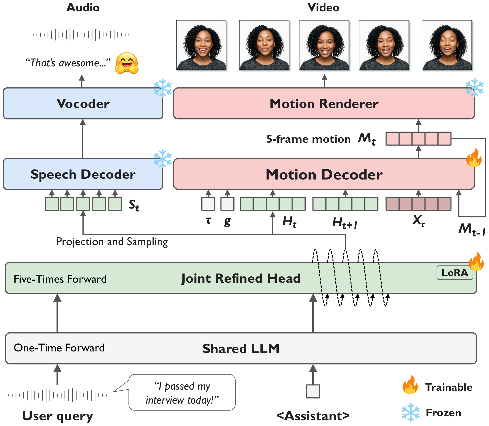

<div align="center">

# JAVIS

**Joint Audio-Visual Interaction and Streaming for Real-Time Conversational Agents**

[Junseok Ahn](https://junseok520.github.io/)<sup>1</sup>&nbsp;·&nbsp;Jaehyun Park<sup>1</sup>&nbsp;·&nbsp;[Jeongsoo Choi](https://choijeongsoo.github.io/)<sup>1</sup>&nbsp;·&nbsp;[Joon Son Chung](https://mm.kaist.ac.kr/joon/)<sup>1</sup>&nbsp;·&nbsp;[Ji-Hoon Kim](https://mintlab.cau.ac.kr/members/faculty)<sup>2</sup>

<sup>1</sup>KAIST&nbsp;&nbsp;&nbsp;<sup>2</sup>Chung-Ang University

[](https://arxiv.org/abs/2610.22499)
[](https://mm.kaist.ac.kr/projects/JAVIS)
[](https://huggingface.co/junseok520/JAVIS)

</div>

> A spoken-dialogue agent that listens to the user and answers with **voice and face at the same time**, streamed in real
> time from a single audio-visual representation.

<div align="center">
  
</div>

## ✨ Highlights

- **One model, two outputs.** A Joint Refined Head on top of [Fun-Audio-Chat-8B](https://github.com/FunAudioLLM/Fun-Audio-Chat)
  produces one representation per 0.2 s; speech tokens and 20-d facial motion are both read from it, frame by frame
  (40 ms each), with 0.2 s of lookahead for the motion.
- **Real-time streaming.** CosyVoice3 and the FLOAT decoder render 1 s audio and video packets while the reply is still
  being generated.
- **Trainable from public data.** Data preparation and two-stage training scripts are included.

<table width="100%">
  <tr><th>setting</th><th>first audio + video packet</th><th>real-time factor</th><th>stalled packets</th></tr>
  <tr><td align="center">2 x RTX 4090, 16.8 s reply</td><td align="center">0.99 s</td><td align="center">0.44</td><td align="center">0 / 34</td></tr>
</table>

Values of the run whose first-packet time is the median of three runs; across the three, the first packet took 0.99–1.40 s
and the real-time factor was 0.44–0.48.

## 🛠️ Installation

**Requirements** (peak GPU memory on RTX 4090 24 GB with the example inputs; 14 s of input, 17 s reply):

| | GPU memory |
|---|---|
| offline inference (`infer.py`) | 21.3 GB on one GPU |
| real-time streaming, two GPUs | 22.6 GB (generation) + 10.2 GB (renderers) |
| real-time streaming, one GPU | ~33 GB (sum of the two peaks above); a 24 GB card runs out of memory (not tested on a single large card) |
| training, stage 1 and 2 | 23.0 GB and 22.9 GB per GPU |

Disk: about 51 GB for inference (JAVIS 38 GB, CosyVoice3 12 GB, FLOAT 0.8 GB). Python 3.12, CUDA 12.8.

```bash
git clone --recursive https://github.com/kaistmm/JAVIS.git && cd JAVIS
conda create -n javis python=3.12 -y && conda activate javis
pip install torch==2.8.0 torchaudio==2.8.0 torchvision --index-url https://download.pytorch.org/whl/cu128
pip install -r requirements.txt
conda install -y -c conda-forge ffmpeg            # video decoding and muxing (ffmpeg, ffprobe)

# FLOAT: motion encoder (data preparation) and face renderer; licensed CC BY-NC-ND 4.0, research use only
git clone https://github.com/deepbrainai-research/float third_party/float
(cd third_party/float && bash download_checkpoints.sh)
```

## 📦 Checkpoints

```bash
huggingface-cli download junseok520/JAVIS --local-dir pretrained_models/JAVIS
huggingface-cli download FunAudioLLM/Fun-CosyVoice3-0.5B-2512 --local-dir pretrained_models/Fun-CosyVoice3-0.5B-2512
```

| path | model | needed for |
|---|---|---|
| `pretrained_models/JAVIS/` | [junseok520/JAVIS](https://huggingface.co/junseok520/JAVIS) | inference |
| `pretrained_models/Fun-CosyVoice3-0.5B-2512/` | [FunAudioLLM/Fun-CosyVoice3-0.5B-2512](https://huggingface.co/FunAudioLLM/Fun-CosyVoice3-0.5B-2512) | inference, data preparation |
| `pretrained_models/Fun-Audio-Chat-8B/` | [FunAudioLLM/Fun-Audio-Chat-8B](https://huggingface.co/FunAudioLLM/Fun-Audio-Chat-8B) | training |
| `third_party/float/checkpoints/float.pth` | [FLOAT](https://github.com/deepbrainai-research/float) | inference, data preparation |

Other locations can be set with `JAVIS_MODEL`, `FLOAT_DIR` and `FLOAT_CKPT`.

## 🚀 Quick Start

The portrait sets the identity and `--voice_ref` the voice (zero-shot cloning). [`examples/`](examples/) holds a synthetic
portrait, a voice sample and a user turn. Generation is half-duplex: the reply starts after the user turn ends.

**Offline**: user wav → reply text, wav and mp4
```bash
python inference/infer.py --audio examples/user.wav --portrait examples/portrait.png \
    --voice_ref examples/voice_ref.wav --out_dir outputs/offline
```

**Real-time streaming**: generation on GPU 0, speech and face renderers on GPU 1
```bash
python inference/stream.py --audio examples/user.wav --portrait examples/portrait.png \
    --voice_ref examples/voice_ref.wav --gen_gpu 0 --render_gpu 1 --cosy_fp16 --fe_gpu --out_dir outputs/stream
```

<details>
<summary>Example log and streaming options</summary>

```
[warmup] done
[packet] audio  0.00- 0.84 s ready at +0.99 s
[packet] video  0.00- 1.00 s ready at +0.99 s
[packet] audio  0.84- 1.84 s ready at +1.33 s
...
[packet] audio 15.84-16.80 s ready at +7.42 s
[joint] user  media 16.80s  wall 7.42s  RTF 0.4414  first-audio 0.99s  first-video 0.99s  first-AV 0.99s  stalls 0/34
```

| option | effect |
|---|---|
| `--render_gpu 0` | everything on one GPU (~33 GB) |
| `--history turns.json` | continue a conversation: `[{"wav": user.wav, "text": assistant reply}, ...]` |
| `--hop 25` | packet length in 25 Hz frames (25 = 1 s) |
| `--no_fast` | plain modules instead of CUDA graphs; RTF 1.13 with 9 / 22 stalls, i.e. not real-time |
| `--no_warmup` | skip the discarded first pass; the first reply then starts ~8 s late |

Each packet is written to `<out_dir>/<tag>.{pcm,rgb}` as soon as it is ready, and `<tag>.json` logs the arrival times,
latency, RTF and stalls. Motion is sampled with 10 Euler steps, temperature 0.7 and guidance 2.0
(`FUNAUDIOCHAT_CFM_STEPS`, `_TEMPERATURE`, `_CFG`).
</details>

## 🏋️ Training

Both stages train only the Joint Refined Head's LoRA and the Motion Decoder, with the same recipe: AdamW at 1e-4, cosine
schedule, global batch 8 (4 GPUs x 1 x 2 accumulation).

| stage | task | data | steps |
|---|---|---|---|
| 1 | monologue: repeat the user's speech | [Talker-T2AV](https://github.com/zhenye234/Talker-T2AV) (≈940k clips) | 117,563 |
| 2 | dialogue: answer the last user turn | [Seamless Interaction](https://github.com/facebookresearch/seamless_interaction) + [MultiDialog](https://multidialog.github.io) (519,076 rows) | 64,885 |

**1. Data.** Every dataset goes through the same scripts; see [`data_prep/README.md`](data_prep/README.md) for the
per-dataset commands. The paper model was additionally trained on JAVIS-Syn (334 h of synthetic dialogues), which is not
released yet.

**2. Train.**
```bash
pip install -e third_party/LLaMA-Factory && pip install flash-attn --no-build-isolation
cd training
bash run_stage1.sh                                          # -> saves/stage1
CONFIG_FILE=configs/merge_stage1.yaml bash run_merge.sh     # -> saves/stage1-merged
bash run_stage2.sh                                          # -> saves/stage2
CONFIG_FILE=configs/merge_stage2.yaml bash run_merge.sh     # -> saves/JAVIS
```
Config keys can be overridden on the command line, e.g. `bash run_stage2.sh max_steps=1000`; for Weights & Biases logging,
`pip install wandb` and add `report_to=wandb`. Memory needs are listed
in the Installation section.

## 📖 Citation

```bibtex
@article{ahn2026javis,
  title   = {JAVIS: Joint Audio-Visual Interaction and Streaming for Real-Time Conversational Agents},
  author  = {Ahn, Junseok and Park, Jaehyun and Choi, Jeongsoo and Chung, Joon Son and Kim, Ji-Hoon},
  journal = {arXiv preprint arXiv:2610.22499},
  year    = {2026}
}
```

## 📄 License

| | license |
|---|---|
| code in this repository | [Apache-2.0](LICENSE) (see also `NOTICE`; it builds on [Fun-Audio-Chat](https://github.com/FunAudioLLM/Fun-Audio-Chat)) |
| model weights ([Hugging Face](https://huggingface.co/junseok520/JAVIS)) | [CC BY-NC 4.0](https://creativecommons.org/licenses/by-nc/4.0/): non-commercial use with attribution |

The weights are non-commercial because the model works in the [FLOAT](https://github.com/deepbrainai-research/float)
motion space, renders faces with the FLOAT decoder, and was trained on data that includes non-commercial sources. FLOAT
itself is licensed under CC BY-NC-ND 4.0 (non-commercial, research use only; see its README), and the face pipeline in this
code is subject to that license when used with FLOAT. The example audio in `examples/` comes from EARS (CC BY-NC 4.0).

## 🙏 Acknowledgments

[Fun-Audio-Chat](https://github.com/FunAudioLLM/Fun-Audio-Chat) ·
[CosyVoice](https://github.com/FunAudioLLM/CosyVoice) ·
[FLOAT](https://github.com/deepbrainai-research/float) ·
[LLaMA-Factory](https://github.com/hiyouga/LLaMA-Factory) ·
[Talker-T2AV](https://github.com/zhenye234/Talker-T2AV) ·
[Seamless Interaction](https://github.com/facebookresearch/seamless_interaction) ·
[MultiDialog](https://multidialog.github.io) ·
[EARS](https://github.com/facebookresearch/ears_dataset)
